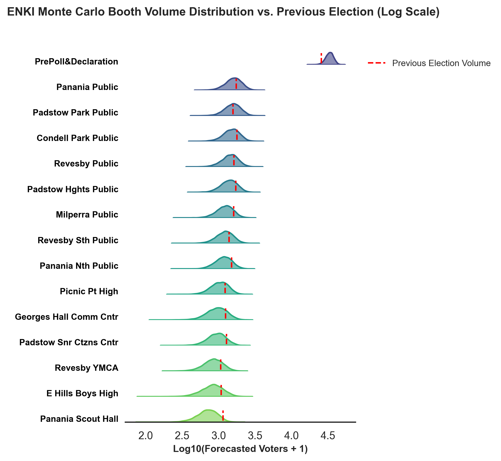
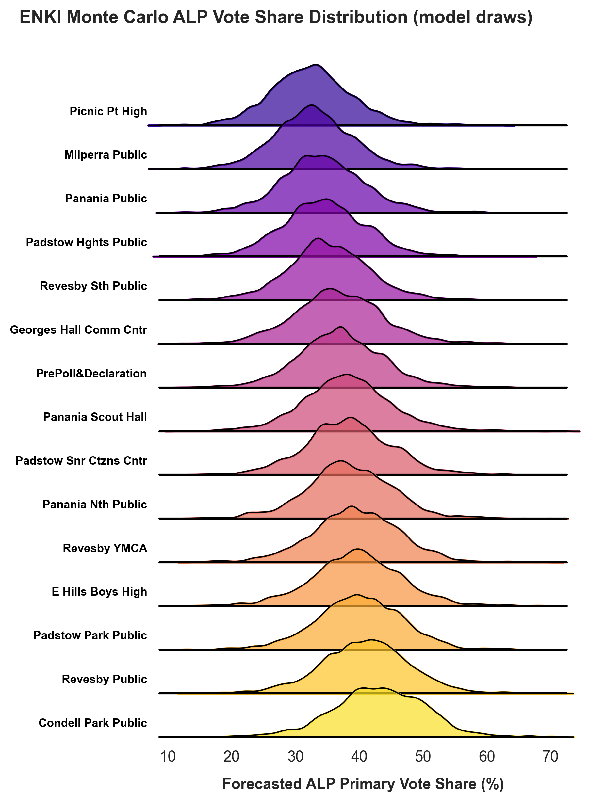
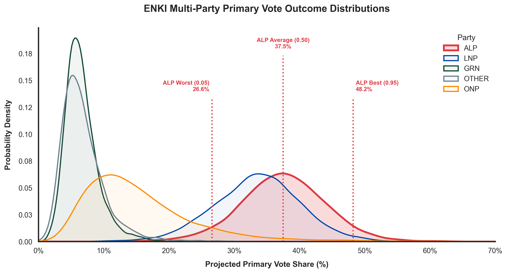

# ELECTION ENGINE

This readme is a wip and is definitely not up to convention on how to write a readme, but you'll have to suck it up and just read whats going on.

---
## Project Metadata

#### **Project Name:** 
ENKI Election Engine

#### **Version:** 
V3.1 (Hierarchical Local Slopes Update)

#### **Author:**
Alec, aka [raeganraegan](https://github.com/raeganraegan) on github.

#### **What does this do:**
It aims to predict the primary vote of an electorate seat by booth and aggregate that into boothwide data predicted for the seat. From this, the aim is to then simulate the OPV preference flows present within the NSW state election.

Note, this has been tuned/calibrated to the upcoming [NSW state election](https://elections.nsw.gov.au/elections/state-elections/2027-nsw-state-election). I'm sure it can be tuned to other elections but that's for another version to implement. Aim is to get this version working before this election and to get actionable booth level data from the twofold prediction of this engine. A bold aim indeed.


#### **How this works:**
This is divided into two parts. 
- [x] Part 1: [ENKI](/ENKI_V3.py) Predicts the primary vote of an election based on historical data
- [ ] Part 2: [INANNA](/INANNA_V2.py) Uses above data and applies OPV preferences to them.

So the overall flow is

$$
In \rightarrow ENKI(In) \rightarrow Out_1 \rightarrow INANNA(Out_1) \rightarrow Out_2
$$

The reason this is split is so that I can program the primary vote calculation distinctly from the OPV flow preference vote. It also eventually if I want to, allows me to substitute INANNA for a different voting system.

#### **Files:**

| File | What it is |
| :--- | :--- |
| `ENKI_V3.py` | The model itself (fit, polls, tide, booths, volumes, ONP, seat) and the `ENKI(x) -> y` entry point. Backtesting still lives here until it gets its own script. |
| `ENKI_HELPERS.py` | Everything that supports the model but is not the model: input checks, plots, output files, terminal report, process-flow bookkeeping. |

#### **Quick start:**

`ENKI(x)` is a blackbox: `x` is one dict (or a path to a `.json`) holding the data, every `ModelConfig` setting and the run options. Anything left out takes its default; an unknown key is an error rather than a silent default.

```python
from ENKI_V3 import ENKI
y = ENKI({"booth_results": "booths.csv", "polls": "polls.csv", "seat_name": "Balmain",
          "registered_electors": 62169, "expected_turnout_rate": 0.91, "output_root": "forecast_output",
          "run_backtest": False})   # the backtest is on by default and refits once per past election
y.seat_summary      # seat-wide primary vote per party (mean + percentiles)
y.config            # the fully resolved settings that were actually run
```

--- 
# Election Engine (ENKI_V3.py) V3.1 Model Specifications

This part of the document outlines the step-by-step mathematical model and equation pipeline for [ENKI Election Engine V3.1](/ENKI_V3.py). It starts with the assumptions and notation, gives the whole model in two equations, then walks through each step. Every step lists the function in `ENKI_V3.py` that does it, and says where the code does something the equations alone would not tell you.

**Notation.** Parties are indexed $k = 1..K$, with the **last party (default `OTHER`) as the reference category** ($k=K$). Booths are $b$, past elections are $t = 1..T$, and $n$ is the number of election cycles between the last election and the target ($n=1$ for 2027). $i$ indexes a posterior draw.

## Core Assumptions

* **Booth Continuity:** Polling places maintain consistent catchments over time; historical venue changes are manually merged upfront (`booth_merge`). Booths with no history cannot be forecast, and redistributions that change a booth's catchment are not modelled.
* **Sum-to-One Consistency:** Booth party shares come from a softmax (multinomial-logit link), so every booth sums to 100% in every draw, and so does the volume-weighted seat total.
* **Hierarchical Local Swing Elasticity:** Every non-reference party (default `ALP`, `LNP`, `GRN`) responds to its own statewide log-share swing through a booth-specific sensitivity $\beta_{kb}$, drawn around a party-level mean $\mu_{\beta,k}$. This lets individual catchments differ in how strongly they follow the state. The reference party (`OTHER`) carries **no** statewide term ($\beta_{Kb}=0$): the seat's independents are structurally decoupled from statewide movement, and the `OTHER` poll number is never used to move booth shares. *See Known Limitations: the party-level mean $\mu_{\beta,k}$ is mostly set by its prior, not by the data.*
* **Seat-Wide Local Shift:** Local candidate effects and scandals form an electorate-wide autoregressive trend $d_{kt}$ per party. One persistence $\rho$ is shared by all parties, with prior $\text{Beta}(2,2)$ (so it is positive, mean 0.5).
* **Poll Decay & Error Budget:** Older polls decay exponentially (2-month half-life). Total statewide poll uncertainty combines the polls' sampling error, a house effect (default 1.50 pts) and a time-horizon term $\gamma\sqrt{\tau}$ (default $\gamma = 1.5$, $\tau$ = years from the prediction date to the election). The house effect and $\gamma$ are set by hand, not estimated.
* **Vote Volume Conservation:** Booth volumes are a *share* of a seat total, so a fall in election-day booths shows up as growth in early/postal voting while the total is conserved. The total is either forecast from history or, if you supply enrolment, computed from enrolment × turnout (see Step 5).
* **Wildcard Entry (ONP):** One Nation cannot be inferred from this seat's history, so it enters through explicit rules: *BrianMode* (default 20% of the LNP vote and 5% of the ALP vote go to ONP) or an entry layer scaled from the statewide ONP poll.

---
### Parameter & Input Definitions

* **Inputs & Random Variables:**
  * $\mathbf{Y}$ – Historical booth result matrices
  * $\mathbf{S}$ – Statewide poll aggregate: Dirichlet draws of statewide party shares
  * $\mathbf{z}$ – Standard normal draws used at forecast time (new tide step $z_d$, booth noise $z_\varepsilon$, volume total $z_T$, early-vote step $z_\tau$)
  * $\boldsymbol{\theta}^{(i)}$ – The $i$-th posterior draw of the share model: $\mu_{\beta}, \sigma_\beta, \beta_{kb}, m, \alpha_{kb}, \sigma_\alpha, \rho, \sigma_d, d_{kT}, \sigma_\varepsilon$, plus a (separately drawn) volume-model posterior draw of $a_b, \kappa$ and the volume path

* **Numerator Components (Party Vote Volume):**
  * $V_b$ – Simulated formal votes at booth $b$
  * $f_k$ – Fraction of party $k$'s vote that One Nation takes ($f_k=0$ for every party except `LNP` and `ALP` in BrianMode)
  * $\text{softmax}_k(\dots)$ – Converts the booth's latent score $\boldsymbol{\eta}_b$ into a vote share $p_{kb}$
  * $m_k + \alpha_{kb}$ – Party baseline $m_k$ (log-odds against the reference party for an average booth) and booth-specific offset $\alpha_{kb}$
  * $\beta_{kb}\,x^*_k$ – Statewide swing predictor scaled by the booth's own sensitivity
  * $d^*_k = \rho\, d_{kT} + \sqrt{1-\rho^2}\,\sigma_{d,k} z_d$ – Next-election step of the seat-wide tide
  * $\sigma_{\varepsilon,k} z_\varepsilon$ – Booth-level noise

* **Denominator:**
  * $\sum_b V_b$ – Total seat formal votes ($= T'$ in the modelled-volume path)

* **Volume Parameters:**
  * $T_T$ – Last election's total formal votes (modelled path)
  * $\hat\mu_g,\ \hat\sigma_g$ – Mean and sd of the historical log growth of the seat total. **Plug-in estimates**, not fitted by MCMC (sd floored at 0.03)
  * $a_b$ – Booth size (log-popularity) of booth $b$
  * $\tau_t$ – Early-vote log-share level at election $t$ ($\tau'$ is the forecast value); $\text{early}_b \in \{0,1\}$ flags pre-poll / postal / declaration booths
  * $\kappa$ – Dirichlet concentration of booth shares around their expected values

* **Polling Parameters:**
  * $H$ – Poll half-life (2 months)
  * $\gamma$ – Time-horizon factor (1.5)
  * $\tau$ – **Years from the prediction date to the election date** (not the age of a poll)
  * $\text{age}_i$ – Calendar months between poll $i$ and the latest (as-of) poll

---
### Unified ENKI V3.1 Master Model Equation

#### Abstracted Model

$$
\text{Seat Primary Vote} = \text{Aggregate}\left(\text{Volumes}(\text{Enrolment}, \text{Turnout}) \times \Big[\text{Bayesian Fit}(\text{History}, \text{Priors}) + \text{Local Tide}(\text{Polls}) + \text{Wildcards}(\text{ONP})\Big]\right)
$$

#### Mathematical Model

For each draw $i$ (percentiles are taken over draws):

$$
s_k = \frac{\sum_b V_b \, p'_{kb}}{\sum_b V_b}
$$

where the booth shares and volumes are

$$
\boldsymbol{p}_b = \text{softmax}\Big(\boldsymbol{m} + \boldsymbol{\alpha}_b + \boldsymbol{\beta}_b \odot \boldsymbol{x}^* + \boldsymbol{d}^* + \boldsymbol{\sigma}_\varepsilon \odot \boldsymbol{z}_\varepsilon\Big), \qquad \boldsymbol{x}^* = \ln \boldsymbol{S} - \overline{\ln \boldsymbol{S}}_{\text{history}}
$$

$$
p'_{kb} = (1-f_k)\,p_{kb} \quad (k \text{ a named party}), \qquad p'_{\text{ONP},b} = \sum_{j} f_j\, p_{jb}
$$

$$
\boldsymbol{V} \sim \text{Multinomial}\big(T',\ \boldsymbol{q}\big), \quad \boldsymbol{q} \sim \text{Dirichlet}\big(\kappa\,\text{softmax}(\boldsymbol{a} + \tau'\,\text{early})\big), \quad T' = T_T \exp\!\big(n\hat\mu_g + \sqrt{n}\,\hat\sigma_g z_T\big)
$$

with $\boldsymbol{S} \sim \text{Dirichlet}(\text{conc}\cdot\hat{\boldsymbol{s}})$ from the poll aggregate. If you supply enrolment (`registered_electors`) or `projected_formal_votes`, $\boldsymbol{V}$ is fixed instead (Step 5). If BrianMode is off and `onp_layer` is on, the ONP row is the entry layer of Step 6 instead.

---
## ENKI V3.1 Step by Step

### Pipeline Overview

| Step | Input $\rightarrow$ Output | What happens | Code |
| :--- | :--- | :--- | :--- |
| **0. Prep** | Raw counts $\rightarrow$ $Y, x$ | Formal votes, `OTHER` remainder, centred statewide log-swing | `prepare_bayes_data`, `_build_design` |
| **1. Fit** | $Y, x \rightarrow$ posterior draws $\theta^{(i)}$ | Non-centred hierarchical multinomial-logit, MCMC | `fit_bayesian_model` |
| **2. Polls** | Poll table $\rightarrow$ $S^{(i)}$ | Weighted average, error budget, Dirichlet draws | `poll_summary`, `_poll_draws` |
| **3. Tide** | $\theta, S \rightarrow \text{lin}_{kb}$ | Statewide swing and next tide step, per booth | `_simulate_next` |
| **4. Booth shares** | $\text{lin} \rightarrow p_b$ | Latent score, booth noise, softmax | `_simulate_next` |
| **5. Volumes** | $\rightarrow V_b$ | Enrolment path, or fitted volume model | `projected_votes_from_electors`, `_fit_volume_posterior`, `_simulate_volumes` |
| **6. ONP** | $p_b \rightarrow p'_b$ | BrianMode transfer or entry layer | `_apply_brian_mode`, `_apply_onp_entry` |
| **7. Aggregate** | $\rightarrow y$ | Volume-weighted seat shares, percentiles | `predict_bayes` |

---

## Detailed Model Equations

### 0. Prep

* **What it does:** Turns raw booth counts into formal votes, puts everything outside the named parties into `OTHER`, and builds the statewide swing predictor.
* **Why we do it:** Raw counts cannot be compared across booths of different sizes, and the model needs each party's statewide movement on a log scale, centred so the intercepts keep their meaning.

- **Formal votes:** $n = \text{total} - \text{informal}$
- **Other vote total:** $y_{\text{OTHER}} = n - \sum y_{\text{named}}$
- **Centred statewide log-swing** (a centred log-*share*, not a log-ratio):

$$
x_{kt} = \ln S_{kt} - \overline{\ln S_k}, \qquad \overline{\ln S_k} = \tfrac{1}{T}\textstyle\sum_t \ln S_{kt}
$$

$S_{kt}$ is party $k$'s statewide share at election $t$. By default ONP stays in the denominator (`onp_state_denominator`), so the named-party shares sum to less than 100 and a high ONP poll does not inflate the other parties.

---

### 1. Model Fitting & Priors

* **What it does:** Fits a hierarchical Bayesian model to past election data with MCMC, estimating booth baselines $\alpha_{kb}$, the seat tide $d_{kt}$, booth-level sensitivities $\beta_{kb}$ and the variance parameters.
* **Why we do it:** Polling alone is too coarse to describe booth behaviour. The fit extracts each booth's baseline and how differently each booth reacts to the same statewide movement.

#### Likelihood & Core Equation:

$$
\boldsymbol{y}_{bt} \sim \text{Multinomial}\big(n_{bt},\, \text{softmax}(\boldsymbol{\eta}_{bt})\big)
$$

$$
\eta_{kbt} = m_k + \alpha_{kb} + \beta_{kb} x_{kt} + d_{kt} + \varepsilon_{kbt}, \qquad m_K = 0,\ \ \beta_{Kb} = 0
$$

#### Priors (Non-Centred Parameterisation):

- **Sensitivity (non-reference parties $k<K$):**

$$
\mu_{\beta,k} \sim \mathcal{N}(\text{preset mean},\, \text{preset sd}), \qquad \sigma_{\beta,k} \sim \text{HalfNormal}(0.20), \qquad \beta_{kb} = \mu_{\beta,k} + \sigma_{\beta,k} z_{\beta,kb}
$$

  The `data` preset is mean 0.3, sd 0.30 (GRN sd 0.50); the `uniform` preset is mean 1.0, sd 0.15.
- **Intercepts:** $m_k \sim \mathcal{N}(m_{0,k},\, 1)$, where $m_{0,k}$ is the empirical log-ratio of party $k$ to the reference.
- **Booth offsets and noise:** $\alpha_{kb} = \sigma_{\alpha,k} z, \quad \varepsilon_{kbt} = \sigma_{\varepsilon,k} z$ with $\sigma_{\alpha,k} \sim \text{HalfNormal}(0.25/\sqrt2)$ and $\sigma_{\varepsilon,k} \sim \text{HalfNormal}(0.08/\sqrt2)$. The $/\sqrt2$ keeps the log-ratio scale equal to the setting, because $\alpha$, $d$ and $\varepsilon$ exist for all $K$ parties but only differences between parties are identified.
- **Seat tide (AR(1), per party):**

$$
d_{k,1} = \sigma_{d,k} z, \qquad d_{kt} = \rho\, d_{k,t-1} + \sqrt{1-\rho^2}\,\sigma_{d,k}\, z
$$

- **Hyperparameters:**

$$
\rho \sim \text{Beta}(2, 2), \qquad \sigma_{d,k} \sim \text{LogNormal}\!\left(\ln 0.3 - \tfrac12 \ln 2,\ 0.7\right)
$$

- **LNP baseline floor:** the `LNP` booth offset is floored at $-1.38$ (`pt.where`). At the current $\sigma_\alpha$ this is about seven standard deviations out and never binds. Its purpose is not documented in the code.

---

### 2. Polling Aggregation

* **What it does:** Combines the statewide polls into one set of Dirichlet draws of statewide party shares, weighting recent polls higher and inflating the variance for house effect and time to the election.
* **Why we do it:** Individual polls carry sampling noise and house bias, and the election is still some time away.

- **Recency weight:** $w_i = 0.5^{\,\text{age}_i / H}$ (age in whole calendar months before the latest poll)
- **Weighted mean:** $\hat{s}_k = \dfrac{\sum_i w_i s_{ik}}{\sum_i w_i}$, then renormalised so all shares, ONP included, sum to 100
- **Error budget** (uses the **target party's** share $p$; in points, converted to a proportion):

$$
\text{se}^2 = \text{se}_{\text{poll}}^2 + \sigma_{\text{house}}^2 + \gamma^2 \tau, \qquad \text{se}_{\text{poll}}^2 = \frac{\sum_i w_i^2\, p(1-p)/n_i}{(\sum_i w_i)^2}
$$

- **Concentration** (matches the Dirichlet variance of the target party to $\text{se}^2$):

$$
\text{conc} = \max\!\left(\frac{p(1-p)}{\text{se}^2} - 1,\ 10\right)
$$

- **Draws:**

$$
\boldsymbol{X} \sim \text{Dirichlet}(\text{conc} \cdot \hat{\boldsymbol{s}}/100), \qquad \boldsymbol{S} = \boldsymbol{X}_{1..K},\quad S_{\text{ONP}} = X_{K+1}
$$

  If the poll table has no `ONP` column, there is no extra component. One `conc` (from the target party) is applied to every party, so the other parties' spreads are implied by their shares rather than modelled separately.

---

### 3. Local Tide

* **What it does:** Combines the statewide swing $x^*$ with the next step of the seat's autoregressive tide $d^*$ into a party shift that differs by booth.
* **Why we do it:** State tides push parties up or down, but each booth absorbs that swing at its own rate, and the seat also has its own persistent local trend.

- **Swing:** $x^*_k = \ln S_k - \overline{\ln S_k}$ (the same centring as Step 0, using the fitting window's mean)
- **Next tide step:** $d^*_k = \rho\, d_{kT} + \sqrt{1-\rho^2}\,\sigma_{d,k}\, z_d$, where $d_{kT}$ is the last fitted tide
- **Shift:**

$$
\text{lin}_{kb} = \beta_{kb}\, x^*_k + d^*_k
$$

All of $\rho, \sigma_d, d_{kT}, \beta_{kb}$ come from the same posterior draw $i$. For the reference party $\beta_{Kb} = 0$, so $\text{lin}_{Kb} = d^*_K$.

---

### 4. Booth Shares

* **What it does:** Adds the baseline, the shift and booth noise, then applies the softmax.
* **Why we do it:** It turns the abstract shifts into explicit party probabilities that sum to 100% at every booth in every draw.

$$
\eta_{kb} = m_k + \alpha_{kb} + \text{lin}_{kb} + \sigma_{\varepsilon,k} z_\varepsilon, \qquad \boldsymbol{p}_b = \text{softmax}(\boldsymbol{\eta}_b)
$$

The booth noise (`include_eps`, on by default) is a fresh draw for every booth and party, independent across booths.

---

### 5. Turnout & Volumes

* **What it does:** Produces the number of formal votes $V_b$ at each booth.
* **Why we do it:** Seat totals must be weighted by how many people actually vote at each booth, and the early-vote share keeps changing.

There are three paths, checked in this order:

**(a) You supply `projected_formal_votes`:** $V_b$ is exactly your vector in every draw.

**(b) You supply `registered_electors` (what `main()` does by default):** deterministic.

$$
V_b = E \cdot r \cdot (1-\iota) \cdot \frac{n_{b,\text{last}}}{\sum_{b'} n_{b',\text{last}}}
$$

$E$ = `registered_electors`, $r$ = `expected_turnout_rate`, $\iota$ = the historical informal rate in the booth file. **No volume uncertainty is added in this path.**

**(c) Neither is supplied: the fitted volume model.** Fitted separately by MCMC (independent of the share model):

$$
\boldsymbol{n}_t \sim \text{DirichletMultinomial}\big(T_t,\ \kappa\,\text{softmax}(\boldsymbol{a} + \tau_t\,\text{early})\big)
$$

with $a_b = \sigma_a z_b,\ \sigma_a \sim \text{HalfNormal}(1.5)$, early-vote levels $\tau_t \sim \mathcal{N}(0, 0.5)$ (pinned at 0 up to the first election that had an early-voting booth) and $\kappa \sim \text{Gamma}(2, 0.005)$. The forecast below uses the differences between consecutive $\tau_t$ as the "steps". The forecast then uses

- **Total:** $T' = T_T \exp\!\big(n\hat\mu_g + \sqrt{n}\,\hat\sigma_g z_T\big)$
- **Early-vote level:** $\tau' = \tau_{\text{last}} + n\,\delta + \sqrt{n}\,\sigma_\tau z_\tau$, with drift $\delta$ = last historical step (default; `volume_drift` can be `mean` or `none`) and $\sigma_\tau$ floored at 0.25
- **Booth split:** $\boldsymbol{\pi} = \text{softmax}(\boldsymbol{a} + \tau'\,\text{early})$, $\ \boldsymbol{q} \sim \text{Dirichlet}(\kappa\boldsymbol{\pi})$ over booths that were active at the last election, $\ \boldsymbol{V} \sim \text{Multinomial}(T', \boldsymbol{q})$

Draws of $(a, \kappa)$ are picked at random from the volume posterior, so they are independent of the share model's draw $i$.

---

### 6. One Nation (ONP) Adjustment Layer

* **What it does:** Moves vote to One Nation by explicit rules.
* **Why we do it:** ONP runs sporadically and cannot be predicted from this seat's history, so it is a scenario input rather than a fitted effect. ONP is never one of the fitted parties.

Two layers; if both are on, **BrianMode wins** and the entry layer is skipped.

- **BrianMode** (off in `ModelConfig`; `main()` switches it on. $f_{\text{LNP}} = 0.20,\ f_{\text{ALP}} = 0.05$, every other $f_k = 0$):

$$
p'_{kb} = (1 - f_k)\,p_{kb}, \qquad p'_{\text{ONP},b} = \sum_{k} f_k\,p_{kb}
$$

  Mass is conserved at every booth. The fractions are constants: they carry no uncertainty and do not use the ONP poll.

- **Entry layer** (`onp_layer`, uses the statewide ONP poll draw $S_{\text{ONP}}$):

$$
s = \text{clip}\!\left(\kappa_{\text{ONP}}\, S_{\text{ONP}}/100,\ 0,\ s_{\max}\right), \quad \kappa_{\text{ONP}} \sim \text{LogNormal}(\ln 0.65,\ 0.5)
$$

$$
p'_{kb} = (1-s)\,p_{kb}, \qquad p'_{\text{ONP},b} = s
$$

  $\kappa_{\text{ONP}}$ is the seat-to-statewide ONP ratio (East Hills 1999: 10.7 / 6.4) and is unrelated to the volume $\kappa$. The same $s$ applies to every booth.

---

### 7. Final Aggregation

* **What it does:** Multiplies booth shares by booth volumes, sums over booths and divides by the total, once per draw.
* **Why we do it:** It aggregates booth-level predictions into the seat-wide primary vote.

$$
s_k = \frac{\sum_b V_b \, p'_{kb}}{\sum_b V_b}
$$

Percentiles (default 5 / 50 / 95) are taken over the draws. Each draw combines the share-model posterior, the poll draw, the tide step, booth noise, the volume draw and the ONP layer, so the bands are **predictive intervals** for the whole pipeline, not confidence intervals for $\theta$.

---
## Known Limitations

Things the model does not do, or does only weakly. None are bugs; they bound what the numbers mean.

- **The party-level slope $\mu_{\beta,k}$ is mostly set by its prior.** $\mu_\beta x_{kt}$ and the free year effect $d_{kt}$ both vary only by year and party, so the data cannot separate "the seat followed the state" from "a local tide". Only the booth-to-booth differences ($\sigma_\beta z_b x_{kt}$) are identified from the data. The headline seat response to a poll movement is roughly $\mu_\beta x^*$, so it depends on the preset. Fitting several seats together, or reporting a prior-sensitivity run on $\mu_\beta$, is the proper fix.
- **The reference party matters.** Setting $\beta_K = 0$ for `OTHER` makes the model depend on which party is last in `parties`.
- **The poll error budget is hand-set** ($\sigma_{\text{house}} = 1.5$, $\gamma = 1.5$). One concentration is derived from the target party and applied to all parties; party errors cannot be positively correlated.
- **Booth noise is independent across booths**, so it averages out in the seat total; if real booth swings are correlated, the seat band is too narrow.
- **ONP rules are deterministic.** BrianMode has no uncertainty on $f_k$ and ignores the ONP poll. Past ONP votes sit inside the fitted `OTHER`, so some double-counting is possible.
- **Volume** (path c): $\hat\mu_g$ and $\hat\sigma_g$ are plug-ins from a handful of past elections, and the early-vote drift extrapolates the last step. Path (b) has no volume uncertainty at all.
- **No new booths, no redistribution.** See Core Assumptions.

---
# What does this output?

Other than the boring ah excel spreadsheets you can sift through after each generation, ENKI generates beautiful plots like such (example only):







As should be somewhat self evident, the program produces all the probability distributions for election volume, primary vote share by party, the electoral tide based on polling data, as well as other local parameters that are evident. 

Each run also saves `inputs_resolved.json` (every setting actually used) and, with `record_trace` on, a `trace.npz` holding the signal at each step above.

---
# V3 Planned Changes

All my changes are currently geared towards better defining what is going on in ENKI. ENKI predicts the primary vote and so the OPV flows kinda depend on it. It is the foundation of which the models' reality is built on, so its really important that what's going on in ENKI is clear as crystal.

I'm currently working on the following (ticked off if completed):
- [x] **Refactor Helpers out of ENKI** (`ENKI_HELPERS.py`) to keep the main script clean.
- [ ] **Move Backtests out of ENKI** into their own script so backtesting can run independently. They still live in `ENKI_V3.py` for now.
- [x] **Implement Hierarchical Booth Random Slopes ($\beta_{kb}$)** so the sampler can discover how much booths differ in swing elasticity, rather than imposing one uniform sensitivity. (The party-level mean is still prior-driven; see Known Limitations.)
- [ ] **Process Flow Diagram for ENKI**: I am intending on making ENKI spitout a simple [process flow diagram](https://asq.org/quality-resources/flowchart?srsltid=AYCX9vIusrYvqunG4h8_QuA-vRr4EV05yenmEM4xUvJyED7qOLBBL8ri) that highlights each of the steps taken by ENKI in transforming the input data into the output data. The intention is a PDF output for 'logging' purposes where the first page is this process flow diagram and each following page shows the values generated on one step, together with checks that the step's invariants held (shares sum to 100, mass conserved by ONP, and so on). A PDF cannot hold every draw, so the aim is: the PDF shows the summaries and checks, and a companion CSV per step holds the numbers you would need to re-trace a step by hand in excel. It's an accountability thing.
- [ ] **Laplace Process Implementation for ENKI**:       
  - Firstly, this needs a serious conceptual reality check before I even touch this. Need to know if this is applicable. ENKI is nonlinear (log, softmax), stochastic, and steps once per election, so a transfer function $G(s)$ only makes sense for individual blocks (the poll smoother is a first-order low-pass filter with time constant $H/\ln 2$; the tide is a discrete first-order filter with its pole at $\rho$).
  - The useful question is a sensitivity one: how does a change in the One Nation input move the primary vote output (e.g. seat-share change per point of statewide ONP)? That can be measured by re-running the forecast with the ONP input stepped, ramped or pulsed, rather than by writing down $U(s)G(s)=Y(s)$ for the whole system. This step is totally experimental, its just applying some chem eng stuff to this process to see if its useful at all.

Once thats done its a matter of doubling down into INANNA and making that ironclad.


# Why so little information on INANNA?

Cos i will get to that in time, rn i need to establish that ENKI is working fine. I partitioned the program like this so I can work on it in distinct parts.
