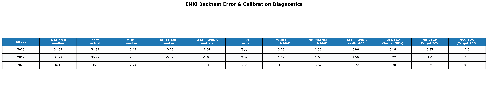
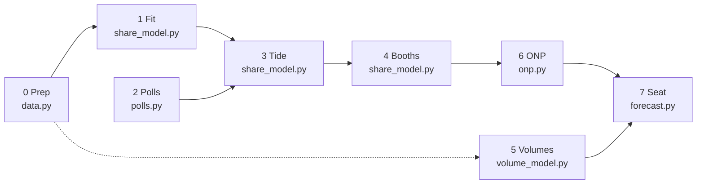

# ELECTION ENGINE

This readme is a wip and is definitely not up to convention on how to write a readme, but you'll have to suck it up and just read whats going on.

## Project Metadata

#### **Project Name:**

ENKI Election Engine

#### **Version:**

V3.3 (Package refactor: the model is now the `enki/` package)

#### **Author:**

Alec, aka [raeganraegan](https://github.com/raeganraegan) on github.

#### **What does this do:**

It aims to predict the primary vote of an electorate seat by booth and aggregate that into boothwide data predicted for the seat. From this, the aim is to then simulate the OPV preference flows present within the NSW state election.

Note, this has been tuned/calibrated to the upcoming [NSW state election](https://elections.nsw.gov.au/elections/state-elections/2027-nsw-state-election). I'm sure it can be tuned to other elections but that's for another version to implement. Aim is to get this version working before this election and to get actionable booth level data from the twofold prediction of this engine. A bold aim indeed.

#### **How this works:**

This is divided into two parts.

* [x] Part 1: [ENKI](/enki/) Predicts the primary vote of an election based on historical data

* [ ] Part 2: [INANNA](/INANNA_V2.py) Uses above data and applies OPV preferences to them.

So the overall flow is

$$
\text{In} \rightarrow \text{ENKI}(\text{In}) \rightarrow \text{Out}_1 \rightarrow \text{INANNA}(\text{Out}_1) \rightarrow \text{Out}_2
$$

The reason this is split is so that I can program the primary vote calculation distinctly from the OPV flow preference vote. It also eventually if I want to, allows me to substitute INANNA for a different voting system.

#### **Files:**

Dependencies point one way only: each module imports from the ones above it, never below.

| File | What it is |
| ----- | ----- |
| `enki/config.py` | Every setting (`ModelConfig`, `RunOptions`), defaults, validation. No logic. |
| `enki/data.py` | Booth CSV -> clean table, statewide results, `NSW_STATE_RESULTS`. |
| `enki/polls.py` | Step 2: poll average, error budget, statewide Dirichlet draws. |
| `enki/share_model.py` | Steps 0, 1, 3, 4: the PyMC fit and `simulate_shares`. |
| `enki/volume_model.py` | Step 5: booth volumes (projected / electors / fitted). |
| `enki/onp.py` | Step 6: One Nation (`none` / `brian` / `entry`). |
| `enki/pipeline.py` | Step registry, `build_trace`, `check_trace`. |
| `enki/forecast.py` | Runs the steps once, builds result tables and uncertainty attribution. |
| `enki/backtest.py` | Walk-forward validation and scoring (coverage, CRPS, baselines). Depends on the model, never the reverse. |
| `enki/plots.py`, `io.py`, `report.py` | Figures, files in/out, terminal report. |
| `enki/api.py` | `ENKI(x) -> y`, input resolution, CLI. |
| `ENKI_V3.py` | 3-line facade so old `from ENKI_V3 import ENKI` still works. |

Run `python tests/test_enki.py` (no PyMC needed: the sampler is replaced by a synthetic posterior).

#### **Quick start:**

`ENKI(x)` is a blackbox: `x` is one dict (or a path to a `.json`) holding the data, every `ModelConfig` setting and the run options. Anything left out takes its default; an unknown key is an error rather than a silent default.

```python
from enki import ENKI
y = ENKI({"booth_results": "booths.csv", "polls": "polls.csv", "seat_name": "Balmain",
          "registered_electors": 62169, "expected_turnout_rate": 0.91, "output_root": "forecast_output",
          "onp_mode": "none",        # "none" | "brian" | "entry"
          "run_backtest": False})    # the backtest is on by default and refits once per past election
y.seat_summary      # seat-wide primary vote per party (mean + percentiles)
y.config            # the fully resolved settings that were actually run
```

Old keys give a precise error naming their replacement (`brian_mode` -> `onp_mode='brian'`, `onp_layer` -> `onp_mode='entry'`, `local_priors`/`beta_g`/... -> `beta_priors`).

# What does this output?

Other than the boring ah excel spreadsheets you can sift through after each generation, ENKI generates beautiful plots like such (example only):


It also generates some tables on the backtesting so you can see how it performed in the past.



And a few excel sheets, and `npz` that are characteristic of the simulation as well.

As should be somewhat self evident, the program produces all the probability distributions for election volume, primary vote share by party, the electoral tide based on polling data, as well as other local parameters that are evident.

Each run also saves `inputs_resolved.json` (every setting actually used) and, with `record_trace` on, a `trace.npz` holding the signal at each step above.

# Election Engine (`enki/`) Model Specifications

This part of the document outlines the step-by-step mathematical model and equation pipeline for [ENKI Election Engine](/enki/). It starts with the assumptions and notation, gives the whole model in two equations, then walks through each step. Every step lists the function in `ENKI_V3.py` that does it, and says where the code does something the equations alone would not tell you.

**Notation.** Parties are indexed $k = 1 \dots K$, with the **last party (default `OTHER`) as the reference category** ($k=K$). Booths are $b$, past elections are $t = 1 \dots T$, and $n$ is the number of election cycles between the last election and the target ($n=1$ for 2027). $i$ indexes a posterior draw.

## Core Assumptions

* **Booth Continuity:** Polling places maintain consistent catchments over time; historical venue changes are manually merged upfront (`booth_merge`). Booths with no history cannot be forecast, and redistributions that change a booth's catchment are not modelled.

* **Sum-to-One Consistency:** Booth party shares come from a softmax (multinomial-logit link), so every booth sums to 100% in every draw, and so does the volume-weighted seat total.

* **Hierarchical Local Swing Elasticity:** Every non-reference party (default `ALP`, `LNP`, `GRN`) responds to its own statewide log-share swing through a booth-specific sensitivity $\beta_{kb}$, drawn around a party-level mean $\mu_{\beta,k}$. This lets individual catchments differ in how strongly they follow the state. The reference party (`OTHER`) carries **no** statewide term ($\beta_{Kb}=0$): the seat's independents are structurally decoupled from statewide movement, and the `OTHER` poll number is never used to move booth shares. *See Known Limitations: the party-level mean* $\mu_{\beta,k}$ *is mostly set by its prior, not by the data.*

* **Seat-Wide Local Shift & Dynamics:** Local candidate effects and scandals form an electorate-wide trend $d_{kt}$ per party. Configured either via stationary AR(1) persistence $\rho$ (`tide_process="ar1"`, prior $\text{Beta}(2,2)$) or a non-stationary secular drift (`tide_process="random_walk"`).

* **Correlated Error Innovations (Optional):** Shocks across parties can be coupled via an LKJ Cholesky covariance matrix (`use_correlated_errors=True`), reflecting structured inter-party leakage rather than orthogonal independent noise.

* **Poll Decay & Error Budget:** Older polls decay exponentially (2-month half-life). Total statewide poll uncertainty combines the polls' sampling error, a house effect (default `poll_house_sd` 1.50 pts) and a time-horizon term $\gamma\sqrt{\tau}$ (default `time_horizon_gamma` $\gamma = 0.8$, $\tau$ = years from the prediction date to the election). The house effect and $\gamma$ are set by hand, not estimated.

* **Vote Volume Conservation:** Booth volumes are a *share* of a seat total, so a fall in election-day booths shows up as growth in early/postal voting while the total is conserved. The total is either forecast from history or, if you supply enrolment, computed from enrolment $\times$ turnout (see Step 5).

* **Wildcard Entry (ONP):** One Nation cannot be inferred from this seat's history, so it enters through one explicit rule chosen by `onp_mode`: `"brian"` (default 20% of the LNP vote and 5% of the ALP vote go to ONP; set with `brian_transfer`) or `"entry"` (scaled from the statewide ONP poll, which must then exist in the polls table).

### Parameter & Input Definitions

* **Inputs & Random Variables:**

  * $\mathbf{Y}$ – Historical booth result matrices

  * $\mathbf{S}$ – Statewide poll aggregate: Dirichlet draws of statewide party shares

  * $\mathbf{z}$ – Standard normal draws used at forecast time (new tide step $z_d$, booth noise $z_{\varepsilon}$, volume total $z_T$, early-vote step $z_{\tau}$)

  * $\boldsymbol{\theta}^{(i)}$ – The $i$-th posterior draw of the share model: $\mu_{\beta}, \sigma_\beta, \beta_{kb}, m, \alpha_{kb}, \sigma_\alpha, \rho, \sigma_d, d_{kT}, \sigma_\varepsilon, \mathbf{L}_{\Omega}$ (if LKJ enabled), plus a volume-model posterior draw of $a_b, \kappa$ and the volume path

* **Numerator Components (Party Vote Volume):**

  * $V_b$ – Simulated formal votes at booth $b$

  * $f_k$ – Fraction of party $k$'s vote that One Nation takes ($f_k=0$ for every party except `LNP` and `ALP` in `onp_mode="brian"`)

  * $\text{softmax}_k(\dots)$ – Converts the booth's latent score $\boldsymbol{\eta}_b$ into a vote share $p_{kb}$

  * $m_k + \alpha_{kb}$ – Party baseline $m_k$ (log-odds against the reference party for an average booth) and booth-specific offset $\alpha_{kb}$

  * $\beta_{kb}\thinspace x^{\ast}_k$ – Statewide swing predictor scaled by the booth's own sensitivity

  * $d^{\ast}_k$ – Next-election step of the seat-wide tide ($\rho\thinspace  d_{kT} + \sqrt{1-\rho^2}\thinspace \sigma_{d,k} z_d$ for AR(1); $d_{kT} + \sigma_{d,k} z_d$ for Random Walk)

  * $\sigma_{\varepsilon,k} z_\varepsilon$ – Booth-level noise (or correlated multivariate shock $\mathbf{L}_{\Omega} \boldsymbol{z}_\varepsilon$)

* **Denominator:**

  * $\sum_b V_b$ – Total seat formal votes ($= T'$ in the modelled-volume path)

* **Volume Parameters:**

  * $T_T$ – Last election's total formal votes (modelled path)

  * $\hat\mu_g,\ \hat\sigma_g$ – Mean and sd of the historical log growth of the seat total. **Plug-in estimates**, not fitted by MCMC (sd floored at 0.03)

  * $a_b$ – Booth size (log-popularity) of booth $b$

  * $\tau_t$ – Early-vote log-share level at election $t$ ($\tau'$ is the forecast value); $\text{early}_b \in \lbrace 0,1\rbrace$ flags pre-poll / postal / declaration booths

  * $\kappa$ – Dirichlet concentration of booth shares around their expected values

* **Polling Parameters:**

  * $H$ – Poll half-life (2 months)

  * $\gamma$ – Time-horizon factor (0.8)

  * $\tau$ – **Years from the prediction date to the election date** (not the age of a poll)

  * $\text{age}_i$ – Calendar months between poll $i$ and the latest (as-of) poll

### Unified ENKI Master Model Equation

#### Abstracted Model

$$
\text{Seat Primary Vote} = \text{Aggregate}\left(\text{Volumes}(\text{Enrolment}, \text{Turnout}) \times \Big[\text{Bayesian Fit}(\text{History}, \text{Priors}) + \text{Local Tide}(\text{Polls}) + \text{Wildcards}(\text{ONP})\Big]\right)
$$

#### Mathematical Model

For each draw $i$ (percentiles are taken over draws):

$$
s_k = \frac{\sum_b V_b \, p'_{kb}}{\sum_b V_b}
$$

where the booth shares and volumes are

$$
\boldsymbol{p}_b = \text{softmax}\Big(\boldsymbol{m} + \boldsymbol{\alpha}_b + \boldsymbol{\beta}_b \odot \boldsymbol{x}^* + \boldsymbol{d}^* + \boldsymbol{\varepsilon}_b\Big), \qquad \boldsymbol{x}^* = \ln \boldsymbol{S} - \overline{\ln \boldsymbol{S}}_{\text{history}}
$$

$$
p'_{kb} = (1-f_k)\,p_{kb} \quad (k \text{ a named party}), \qquad p'_{\text{ONP},b} = \sum_{j} f_j\, p_{jb}
$$

$$
\boldsymbol{V} \sim \text{Multinomial}\big(T',\ \boldsymbol{q}\big), \quad \boldsymbol{q} \sim \text{Dirichlet}\big(\kappa\,\text{softmax}(\boldsymbol{a} + \tau'\,\text{early})\big), \quad T' = T_T \exp\!\big(n\hat\mu_g + \sqrt{n}\,\hat\sigma_g z_T\big)
$$

with $\boldsymbol{S} \sim \text{Dirichlet}(\text{conc}\cdot\hat{\boldsymbol{s}})$ from the poll aggregate. If `use_correlated_errors=True`, error vectors $\boldsymbol{\varepsilon}_b$ and tide shocks $\boldsymbol{z}_d$ are generated via Cholesky factor transformation $\mathbf{L}_{\Omega} \boldsymbol{z}$. If you supply enrolment (`registered_electors`) or `projected_formal_votes`, $\boldsymbol{V}$ is fixed instead (Step 5). With `onp_mode="entry"` the ONP row is the entry layer of Step 6 instead.

## ENKI Step by Step

### Pipeline Overview

The steps are numbered 0 to 7, but they are **not** a single line. Polls (2) and Volumes (5) are side inputs, and Volumes joins only at the very end. Read the "Needs" column, or the diagram, for what actually depends on what.



| Step | Needs | Input $\rightarrow$ Output | What happens | Code |
| ----- | ----- | ----- | ----- | ----- |
| **0. Prep** | raw files | Raw counts $\rightarrow Y, x$ | Formal votes, `OTHER` remainder, centred statewide log-swing | `data.prepare_booths`, `share_model.build_design` |
| **1. Fit** | 0 | $Y, x \rightarrow \boldsymbol{\theta}^{(i)}$ | Non-centred hierarchical multinomial-logit, MCMC | `share_model.fit_share_model` |
| **2. Polls** | polls only | Poll table $\rightarrow S^{(i)}$ | Weighted average, error budget, Dirichlet draws | `polls.summarise_polls`, `polls.draw_statewide` |
| **3. Tide** | 1, 2 | $\boldsymbol{\theta}, S \rightarrow \text{lin}_{kb}$ | Statewide swing and next tide step, per booth | `share_model.simulate_shares` |
| **4. Booth shares** | 3 | $\text{lin} \rightarrow p_b$ | Latent score, booth noise, softmax | `share_model.simulate_shares` |
| **5. Volumes** | 0 (or enrolment) | $\rightarrow V_b$ | Enrolment path, or fitted volume model | `volume_model.resolve_volumes` |
| **6. ONP** | 4 (and 2 if `entry`) | $p_b \rightarrow p'_b$ | `brian` transfer or `entry` layer; mass-conserving | `onp.apply_onp` |
| **7. Aggregate** | 5, 6 | $\rightarrow y$ | Volume-weighted seat shares, percentiles, uncertainty attribution | `forecast.run_forecast` |

Steps 3 and 4 are one function (`simulate_shares`) because the same random draws feed both. Each step returns a typed result (`PollSummary`, `ShareSim`, `VolumeResult`, `OnpResult`) and `pipeline.build_trace` flattens them into the `s<step>_<name>` signals. The step list itself lives in `enki/pipeline.py` (`PIPELINE_STEPS`, `PIPELINE_EDGES`), and `check_trace` flags any step whose signals are missing.

## Detailed Model Equations

### 0. Prep

* **What it does:** Turns raw booth counts into formal votes, puts everything outside the named parties into `OTHER`, and builds the statewide swing predictor.

* **Why we do it:** Raw counts cannot be compared across booths of different sizes, and the model needs each party's statewide movement on a log scale, centred so the intercepts keep their meaning.

* **Formal votes:** $n = \text{total} - \text{informal}$

* **Other vote total:** $y_{\text{OTHER}} = n - \sum y_{\text{named}}$

* **Centred statewide log-swing** (a centred log-*share*, not a log-ratio):

$$
x_{kt} = \ln S_{kt} - \overline{\ln S_k}, \qquad \overline{\ln S_k} = \tfrac{1}{T}\textstyle\sum_t \ln S_{kt}
$$

$S_{kt}$ is party $k$'s statewide share at election $t$. By default ONP stays in the denominator (`onp_state_denominator`), so the named-party shares sum to less than 100 and a high ONP poll does not inflate the other parties.

### 1. Model Fitting & Priors

* **What it does:** Fits a hierarchical Bayesian model to past election data with MCMC, estimating booth baselines $\alpha_{kb}$, the seat tide $d_{kt}$, booth-level sensitivities $\beta_{kb}$ and the variance/covariance parameters.

* **Why we do it:** Polling alone is too coarse to describe booth behaviour. The fit extracts each booth's baseline and how differently each booth reacts to the same statewide movement.

#### Likelihood & Core Equation:

$$
\boldsymbol{y}_{bt} \sim \text{Multinomial}\big(n_{bt},\, \text{softmax}(\boldsymbol{\eta}_{bt})\big)
$$

$$
\eta_{kbt} = m_k + \alpha_{kb} + \beta_{kb} x_{kt} + d_{kt} + \varepsilon_{kbt}, \qquad m_K = 0,\ \ \beta_{Kb} = 0
$$

#### Priors & Dynamics:

* **Sensitivity (non-reference parties $k \lt  K$):**

$$
\mu_{\beta,k} \sim \mathcal{N}(\text{preset mean},\, \text{preset sd}), \qquad \sigma_{\beta,k} \sim \text{HalfNormal}(0.20), \qquad \beta_{kb} = \mu_{\beta,k} + \sigma_{\beta,k} z_{\beta,kb}
$$

The `data` preset is mean 0.3, sd 0.30 (GRN sd 0.35); the `uniform` preset is mean 1.0, sd 0.15. Override any party with `beta_priors={"ALP": (mean, sd)}`. The reference party has no beta, so it has no prior. This is the only way to set beta priors.

* **Intercepts:** $m_k \sim \mathcal{N}(m_{0,k},\thinspace  1)$, where $m_{0,k}$ is the empirical log-ratio of party $k$ to the reference.

* **Booth offsets and noise:** $\alpha_{kb} = \sigma_{\alpha,k} z, \quad \varepsilon_{kbt} = \sigma_{\varepsilon,k} z$ with $\sigma_{\alpha,k} \sim \text{HalfNormal}(0.25/\sqrt{2})$ and $\sigma_{\varepsilon,k} \sim \text{HalfNormal}(s_\varepsilon/\sqrt{2})$.

* **Seat tide process (`tide_process`):**

  * **AR(1) Tide (`"ar1"`):** $d_{k,1} = \sigma_{d,k} z_1, \quad d_{kt} = \rho\thinspace  d_{k,t-1} + \sqrt{1-\rho^2}\thinspace \sigma_{d,k}\thinspace  z_t$, with $\rho \sim \text{Beta}(2, 2)$.

  * **Random Walk (`"random_walk"`):** $d_{k,1} = \sigma_{d,k} z_1, \quad d_{kt} = d_{k,t-1} + \sigma_{d,k}\thinspace  z_t$, modeling secular multi-cycle structural drift.

* **Correlated Shocks (`use_correlated_errors=True`):**
  Uses an LKJ Cholesky decomposition factor:

$$
\mathbf{L}_{\Omega} \sim \text{LKJCholeskyCov}(\eta = 2.0, K)
$$

Only the unit-scale factor of the LKJ matrix is used (the scale of the shocks is carried by $\sigma_d$ and $\sigma_\varepsilon$, so it is not counted twice), and the same factor correlates the shocks in the forecast. To transform standard normal draws via the mapping:

$$
\mathbf{z}_{t} \longrightarrow \mathbf{L}_{\Omega} \mathbf{z}_{t}
$$

modeling structured inter-party leakage.

* **Hyperparameters:** $\sigma_{d,k} \sim \text{LogNormal}\left(\ln s_d - \tfrac{1}{2}\ln 2,\ 0.7\right)$. The scales $s_d$ and $s_\varepsilon$ are **auto-calibrated from the seat's own history** when `sigma_d_median` / `sigma_eps_sd` are `None` (the default): $s_d$ = 1.225 x the mean sd over elections of the seat's log share (clipped to 0.05-0.35), $s_\varepsilon$ = 0.8 x the mean sd over booths of raw share (clipped to 0.01-0.15). Set a number to fix either one. This is empirical Bayes (the data informs both prior and posterior), a heuristic rather than a derivation.

### 2. Polling Aggregation

* **What it does:** Combines the statewide polls into one set of Dirichlet draws of statewide party shares, weighting recent polls higher and inflating the variance for house effect and time to the election.

* **Why we do it:** Individual polls carry sampling noise and house bias, and the election is still some time away.

* **Recency weight:** $w_i = 0.5^{\text{age}_i / H}$ (age in whole calendar months before the latest poll)

* **Weighted mean:** $\hat{s}_k = \frac{\sum_i w_i s_{ik}}{\sum_i w_i}$, then renormalised so all shares, ONP included, sum to 100

* **Error budget** (uses the **target party's** share $p$; in points, converted to a proportion):

$$
\text{se}^2 = \text{se}_{\text{poll}}^2 + \sigma_{\text{house}}^2 + \gamma^2 \tau, \qquad \text{se}_{\text{poll}}^2 = \frac{\sum_i w_i^2\, p(1-p)/n_i}{(\sum_i w_i)^2}
$$

* **Concentration** (matches the Dirichlet variance of the target party to $\text{se}^2$):

$$
\text{conc} = \max\left(\frac{p(1-p)}{\text{se}^2} - 1,\ 10\right)
$$

* **Draws:**

$$
\boldsymbol{X} \sim \text{Dirichlet}(\text{conc} \cdot \hat{\boldsymbol{s}}/100), \qquad \boldsymbol{S} = \boldsymbol{X}_{1..K},\quad S_{\text{ONP}} = X_{K+1}
$$

### 3. Local Tide

* **What it does:** Combines the statewide swing $x^{\ast}_k$ with the next step of the seat's tide $d^{\ast}_k$ into a party shift that differs by booth.

* **Why we do it:** State tides push parties up or down, but each booth absorbs that swing at its own rate, and the seat also has its own persistent local trend.

* **Swing:** $x^{\ast}_k = \ln S_k - \overline{\ln S_k}$

* **Next tide step ($d^{\ast}_k$):**

  * Under AR(1): $d^{\ast}_k = \rho\thinspace  d_{kT} + \sqrt{1-\rho^2}\thinspace \sigma_{d,k} z_d$

  * Under Random Walk: $d^{\ast}_k = d_{kT} + \sigma_{d,k} z_d$

* **Shift:**

$$
\text{lin}_{kb} = \beta_{kb}\, x^*_k + d^*_k
$$

### 4. Booth Shares

* **What it does:** Adds the baseline, the shift and booth noise, then applies the softmax.

* **Why we do it:** It turns the abstract shifts into explicit party probabilities that sum to 100% at every booth in every draw.

$$
\eta_{kb} = m_k + \alpha_{kb} + \text{lin}_{kb} + \sigma_{\varepsilon,k} z_\varepsilon, \qquad \boldsymbol{p}_b = \text{softmax}(\boldsymbol{\eta}_b)
$$

### 5. Turnout & Volumes

* **What it does:** Produces the number of formal votes $V_b$ at each booth.

* **Why we do it:** Seat totals must be weighted by how many people actually vote at each booth, and the early-vote share keeps changing.

There are three paths, checked in this order:

**(a) You supply `projected_formal_votes`:** $V_b$ is exactly your vector in every draw.

**(b) You supply `registered_electors` (what `main()` does by default):** deterministic.

$$
V_b = E \cdot r \cdot (1-\iota) \cdot \frac{n_{b,\text{last}}}{\sum_{b'} n_{b',\text{last}}}
$$

**(c) Neither is supplied: the fitted volume model.** Fitted separately by MCMC (independent of the share model):

$$
\boldsymbol{n}_t \sim \text{DirichletMultinomial}\big(T_t,\ \kappa\,\text{softmax}(\boldsymbol{a} + \tau_t\,\text{early})\big)
$$

### 6. One Nation (ONP) Adjustment Layer

* **What it does:** Moves vote to One Nation by explicit rules.

* **Why we do it:** ONP runs sporadically and cannot be predicted from this seat's history, so it is a scenario input rather than a fitted effect.

* **BrianMode** (`onp_mode="brian"`; $f_{\text{LNP}} = 0.20,\ f_{\text{ALP}} = 0.05$):

$$
p'_{kb} = (1 - f_k)\,p_{kb}, \qquad p'_{\text{ONP},b} = \sum_{k} f_k\,p_{kb}
$$

* **Entry layer** (`onp_mode="entry"`):

$$
s = \text{clip}\left(\frac{\kappa_{\text{ONP}}\, S_{\text{ONP}}}{100},\ 0,\ s_{\max}\right), \qquad p'_{kb} = (1-s)\,p_{kb}, \qquad p'_{\text{ONP},b} = s
$$

### 7. Final Aggregation

* **What it does:** Multiplies booth shares by booth volumes, sums over booths and divides by the total, once per draw.

$$
s_k = \frac{\sum_b V_b \, p'_{kb}}{\sum_b V_b}
$$

## Backtest

`backtest_shares` refits on the elections before each target and predicts it. What it is *given* about the target's statewide result is chosen per election:

| `backtest_state_mode` | Meaning |
| ----- | ----- |
| `"auto"` (default) | **Per election**: if polls exist for that election's cycle they are used, exactly as in a live forecast; otherwise the true statewide result is used and the row says so (`state_mode`, `state_note`). |
| `"polls"` | Strict: polls are required for every backtested election (error if a cycle has none). |
| `"oracle"` | Always the **true** statewide result. Poll error is never tested. |
| `"noised"` | The true result plus the *assumed* error budget (`poll_house_sd`, `time_horizon_gamma`). Cannot check that budget. |

**One master poll file.** The backtest reads the same `polls` table as the live forecast (or a separate `backtest_polls` if you give one). No tagging is needed. A poll belongs to the cycle ending at election *T* if it was taken **after the previous election and on or before *T*** (minus `backtest_poll_horizon_days`, if set). So a poll is never counted for two elections, and a poll taken after *T* never leaks into *T*. A cycle with fewer than `backtest_min_polls` (default 1) polls falls back to the true result. Required columns are the same as for the live forecast: `date` and one column per modelled party (plus `ONP` if `onp_mode="entry"` or `onp_state_denominator` is on; a cycle lacking it falls back and says why). `sample_size` is optional and may be blank. Values may be fractions or percentages.

Election dates come from the built-in NSW list (1988 to 2023). Add or override with `election_dates={2027: "2027-03-27", ...}`. A tagged table (columns `election_year` and `election_date`) is also accepted and used as tagged.

| Other setting | Meaning |
| ----- | ----- |
| `backtest_volume_mode` | `"actual"` (default): true booth volumes weight the seat total. `"modelled"`: volumes from the volume model fitted before the target (one extra fit per election, slow). |
| `backtest_poll_horizon_days` | `"polls"`/`"auto"`: ignore polls within this many days of the election (score a forecast made, say, 180 days out). `"noised"`: the assumed lead time (default 180). |
| `backtest_min_polls` | `"auto"`: minimum polls in a cycle before they are used. |

Reported per target: seat error and the width of the 90% band (`seat_width`); booth MAE, RMSE and CRPS; empirical coverage of the 50/80/90/95% predictive intervals (draws include binomial voting noise); and, on booths present in both elections, the model beside a no-change and a statewide-swing baseline. Where polls were used: the poll's error on the target party (`state_error`), `n_polls`, and `state_z`, how many assumed standard errors the true result was from the poll average. If `state_z` is routinely beyond about 1, `poll_house_sd` and `time_horizon_gamma` are too small. ENKI warns, listing which elections fell back to the true result. Each target has its own random stream (`seed + year`). One Nation is not applied in the backtest. Booths that did not exist before the target are not scored.

**Polls are only useful here if they predate an election you backtest.** A file whose earliest poll is after the 2023 election (as in a file starting May 2023) contributes nothing to any backtest; it belongs entirely to the live forecast. To backtest with polls, add polls from the cycles before 2023, 2019 and so on, to the same file.

## Known Limitations

Things the model does not do, or does only weakly. None are bugs; they bound what the numbers mean.

* **The party-level slope** $\mu_{\beta,k}$ **is mostly set by its prior.** $\mu_\beta x_{kt}$ and the free year effect $d_{kt}$ both vary only by year and party, so the data cannot separate "the seat followed the state" from "a local tide". Fitting several seats together is the proper fix.

* **Spatial Autocorrelation (CAR/SAR) is omitted.** Booth-level noise ($\varepsilon$) is spatially independent; ignoring physical proximity/neighborhood demographic clustering means seat prediction bands can be slightly underdispersed.

* **The backtest is only as honest as its inputs.** Elections with no polls in the master file fall back to the true statewide result (`"auto"`), and `backtest_volume_mode="actual"` uses true volumes. Add historical polls and use `"modelled"` volumes for an end-to-end score. The poll error budget (`poll_house_sd`, `time_horizon_gamma`) is set by hand; `state_z` in a `"polls"` backtest is the check on it.

* **Few elections per seat.** A seat has only a handful of past elections, so a backtest has a handful of seat-level outcomes. Judge the model across many seats, not one.

* **Auto-calibrated prior scales** reuse the data twice and treat a raw-share sd as a log-ratio scale; they are a regularising heuristic.

* **Random effects on the reference party.** `alpha`, `d` and `eps` are drawn for every party including the reference, so the noise on a log-ratio against `OTHER` includes `OTHER`'s own noise. Fixing the reference party's effects at 0 is the standard parameterisation and would remove a redundant degree of freedom; it changes the model, so it has not been done.

* **The reference party matters.** Setting $\beta_K = 0$ for `OTHER` makes the model depend on which party is last in `parties`.

* **Endogenous Volume-Share Linkage.** Volume $\boldsymbol{V}$ and share $\boldsymbol{p}_b$ are sampled independently, ignoring potential joint effects where polarization simultaneously alters turnout and vote choice.

# V3 Planned Changes

I'm currently working on the following (ticked off if completed):

* [x] **Split ENKI into a package** (`enki/`): one module per step, dependencies point one way, no circular imports.

* [x] **Move Backtests out of ENKI** (`enki/backtest.py`; no circular imports).

* [x] **Implement Hierarchical Booth Random Slopes** ($\beta_{kb}$).

* [x] **Implement Secular Random Walk Dynamics & Correlated Party Shocks (Phase 1 Update)**.

* [ ] **Process Flow Diagram for ENKI**: PDF log generation with invariants checks (the step registry and trace in `enki/pipeline.py` are already in place for it).

* [ ] **Laplace Process Sensitivity Analysis**: Experimental transfer function sensitivity checks under ONP steps/ramps.

Once that's done, it's a matter of doubling down into INANNA and making that ironclad.

# Why so little information on INANNA?

Cos i will get to that in time, rn i need to establish that ENKI is working fine. I partitioned the program like this so I can work on it in distinct parts.