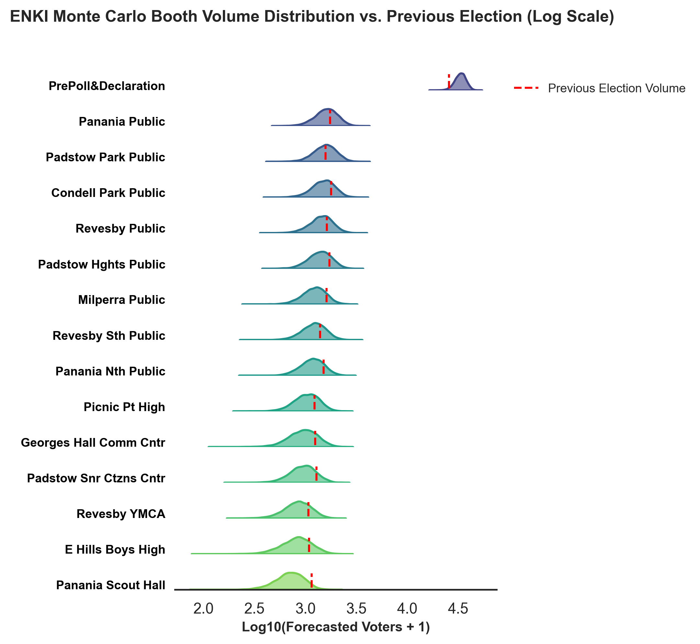
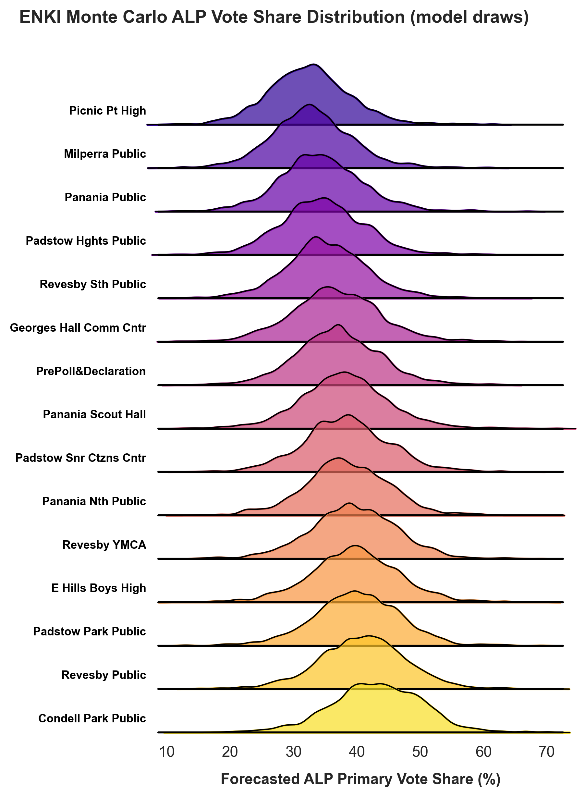
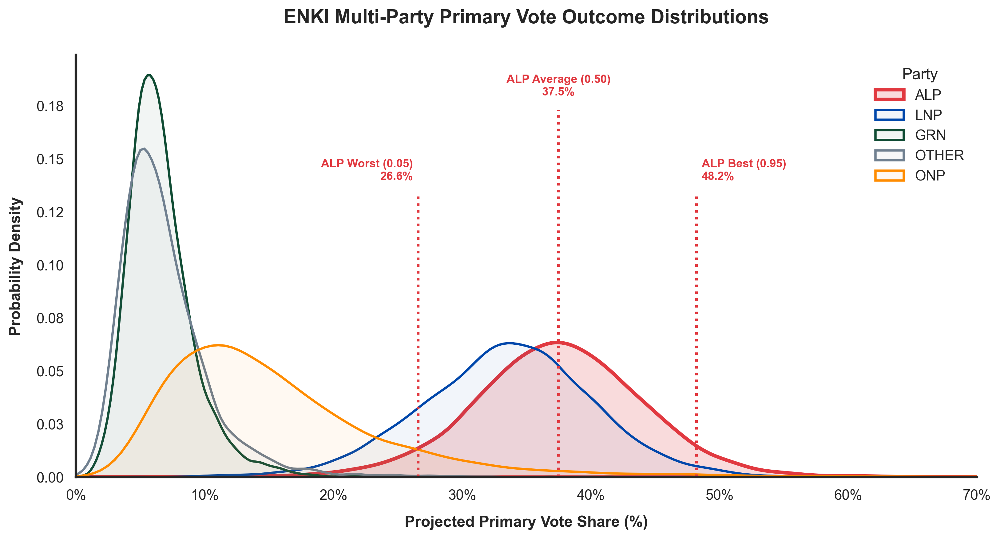
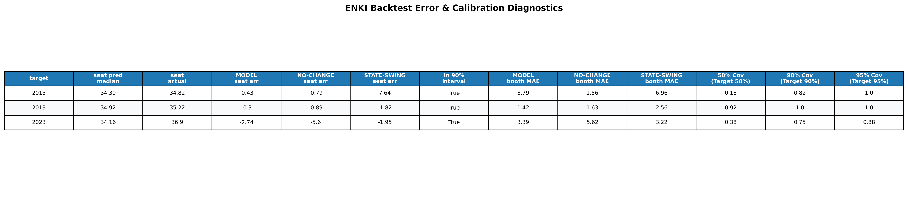
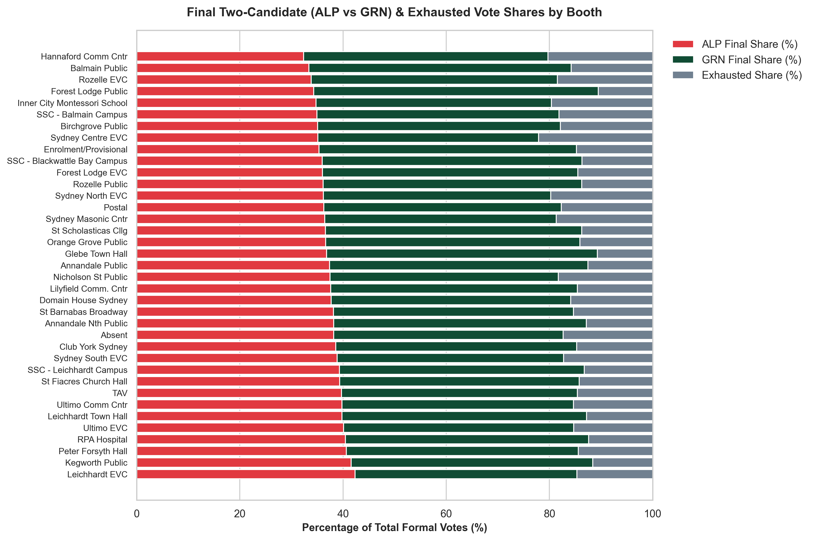
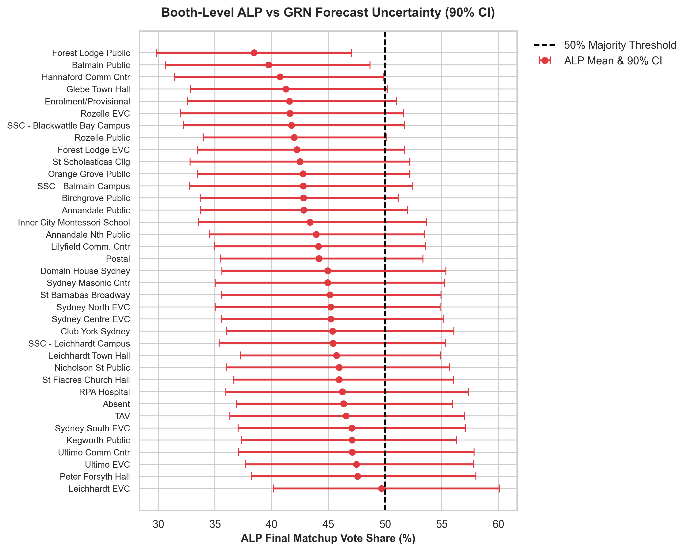
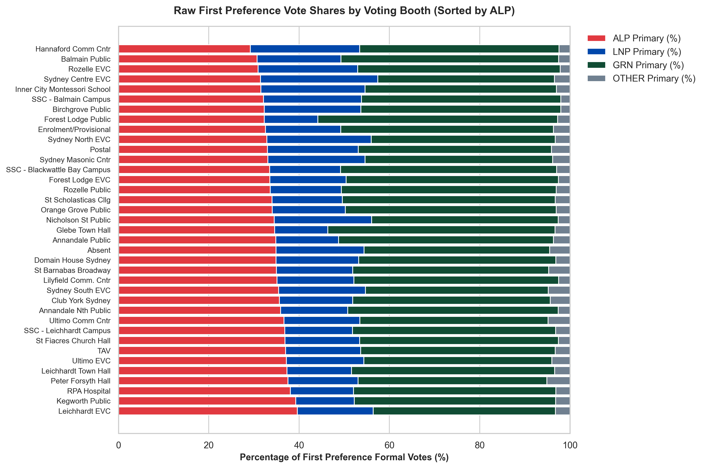
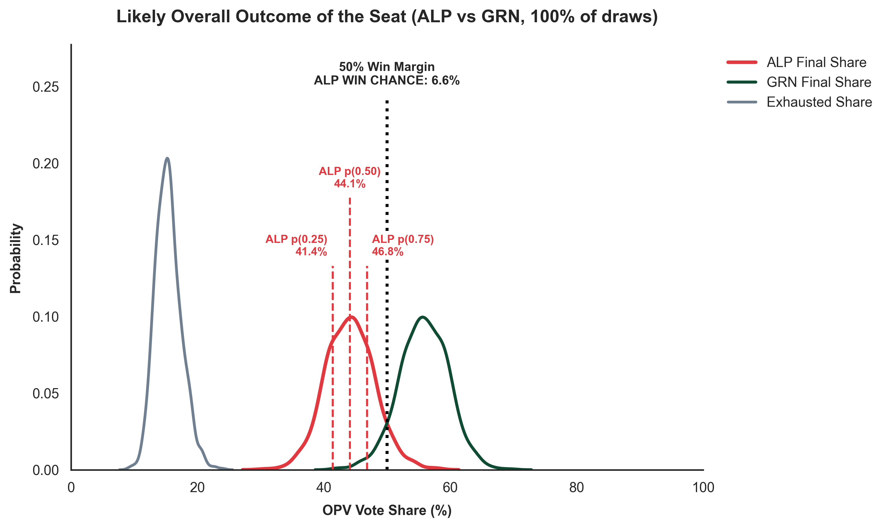
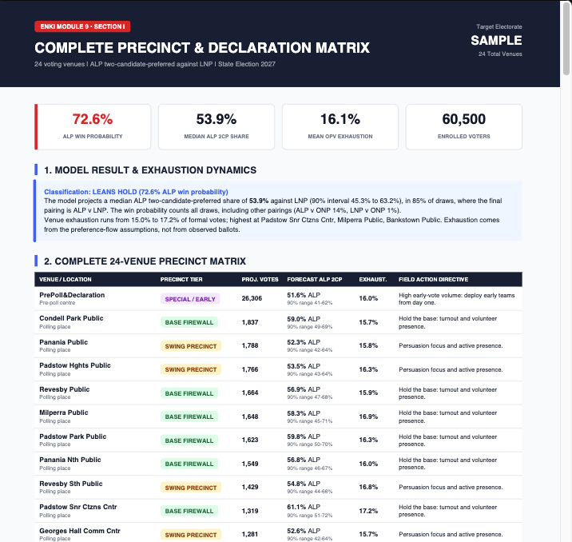
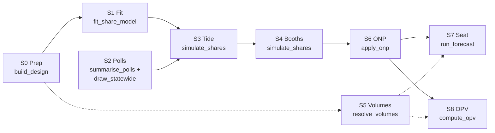

# ELECTION ENGINE

This readme documents ENKI v4.0. **The pretty and relevant outputs are first after the metadata**, *and the project nitty grittys come after that*.

---

## Project Metadata

#### **Project Name:**
ENKI Election Engine

#### **Version:**
V4.0

#### **Author:**
Alec, aka [raeganraegan](https://github.com/raeganraegan) on github.

#### **What does this do:**

ENKI is a Bayesian hierarchical booth-level primary-vote forecast for NSW state elections. Given booth-level historical results and statewide polls, it produces posterior draws of booth and seat-level primary shares, plus optional two-candidate-preferred (2CP), exhaustion, and win-probability outputs. It also runs historical backtests and can emit a strategy PDF (Module 9).

It is tuned/calibrated to the upcoming [NSW state election](https://elections.nsw.gov.au/elections/state-elections/2027-nsw-state-election). Aim is to get actionable booth-level data from the twofold prediction of this engine.

---

## Outputs

Other than CSV spreadsheets and `npz` simulation draws, ENKI generates plots:







It also generates backtest tables:



### OPV Outputs

Written to `<output_root>/<seat>/<date>/ENKI/opv/`

A lot of the uncertainty is generated within this step. One Nation's level is hard to assess — simulate it scenario by scenario (no ONP, extreme ONP, etc). It's on you how you make this sandwich.






### Module 9: Strategy PDF

Written to `<output_root>/<seat>/<date>/ENKI/report/<Seat>_strategy.pdf`

Generates a coherent strategy report (precinct matrix, canvassing priority tiers, deployment framework).



---

## File Layout (`enki/`)

ENKI v4.0 is consolidated into two main modules plus plotting and reporting:

| File | What it is |
| ----- | ----- |
| `enki/enki.py` | **All mathematics** (S0–S8), config dataclasses (`ModelConfig`, `RunOptions`), input resolution (`resolve`), the blackbox `ENKI(x)`, backtesting, CLI (`cli`). Compute only — no file writing. ~2,100 lines. |
| `enki/helpers.py` | **All non-math**: IO (`load_x`, `write_all`), plot orchestration, strategy PDF (Module 9), terminal report printing. Reads arrays/DataFrames; calls `plots.py` for figures. |
| `enki/plots.py` | Figures: seat distribution, booth swing scatter, ridgelines, OPV breakdowns, backtest tables. |
| `enki/report.py` | Terminal report printed at the end of a run. |

Dependencies point one way only: `config, types` → `data` → `polls, share_model` → `volume_model, onp` → `forecast` → `backtest` → `enki` → `reporting/io`.

`config.jsonc` (JSON with `//` comments) at the repo root holds every `ModelConfig` and `RunOptions` field plus the data keys. `Executor.py` reads it and passes the dict to `ENKI(x)`.

Raw data lives in `data/`: `sample_booth_results.csv`, `sample_polls.csv`, `sample_state_results.csv`, `sample_pref_flows.csv`.

---

## Quick start

`ENKI(x)` is a blackbox: `x` is one dict (or a path to a `.jsonc`) holding the data, every `ModelConfig` setting and the run options. **There are no defaults** — every field must be present in `x`. An unknown key is an error rather than a silent default.

```python
from enki import ENKI
from enki.helpers import write_all

x = {
    "seat_name": "Balmain",
    "booth_results": "data/sample_booth_results.csv",
    "polls": "data/sample_polls.csv",
    "state_results": "data/sample_state_results.csv",
    "parties": ["ALP", "LNP", "GRN", "OTHER"],   # LAST party is the reference category
    "election_date": "2027-03-13",
    "prediction_date": "2026-11-16",
    "scenario_pct": [5, 50, 95],
    "onp_mode": "none",        # "none" | "brian" | "entry"
    "total_formal_votes": 52900,  # optional: fixed total formal votes, allocated by Dirichlet
    "output_root": "forecast_output",
    "run_backtest": False,     # backtest refits once per past election — slow
    "run_opv": True,
    "make_pdf": True,          # needs reportlab
    "draws": 500, "tune": 500, "chains": 2, "target_accept": 0.95
}
y = ENKI(x)
write_all(y, x["output_root"])

y.seat_summary      # seat-wide primary vote per party (mean + percentiles)
y.opv               # OPV result: finalist pairings, P(win), 2CP, exhaustion
y.config            # the fully resolved settings that were actually run
```

Or run everything from `Executor.py`, which reads `config.jsonc`:

```bash
python Executor.py
```

Or via the CLI:

```bash
python -m enki config.jsonc
python -m enki config.jsonc seat_name=Balmain draws=1000
```

MCMC defaults are shortened for testing (500/500/2/0.95); use 2000/2000/4/0.99 for a real run.

---

## Dependencies

Python 3.10+. Required:

| Package | Purpose |
| ------- | ------- |
| `pandas` | DataFrames, CSV reading |
| `numpy` | Arrays, random draws |
| `matplotlib` | Plotting |
| `seaborn` | Density/ridgeline plots |
| `pymc` | MCMC fitting (share model, volume model) |
| `arviz` | MCMC diagnostics and posterior extraction |

Optional:

| Package | Purpose |
| ------- | ------- |
| `reportlab` | Module 9 strategy PDF (if absent, PDF becomes a warning) |

Install with:

```bash
pip install pandas numpy matplotlib seaborn pymc arviz reportlab
```

MCMC fitting (Steps 1 and 5 volume model) is the slow part — a single seat forecast with default test settings takes roughly 30–40 seconds; a full backtest refits once per past election and can take several minutes.

---

## Input format spec

All data files live in `data/` and are referenced from `config.jsonc`.

### `data/sample_booth_results.csv` — required

| Column | Type | Notes |
| ------ | ----- | ----- |
| `year` | int | Election year |
| `booth` | string | Booth / voting venue name |
| `total_votes` | int | Total votes cast at booth |
| `informal_votes` | int | Informal (invalid) votes |
| `<party>` | int | One column per modelled party (e.g. `ALP`, `LNP`, `GRN`) |

Optional columns: `booth_type` (used with `early_keywords` to flag early/postal booths), `IND`, `ONP`.

Rows are dropped if they have missing `booth` or `year`, non-numeric vote counts, or non-positive formal votes. Duplicate booth-year rows are summed.

### `data/sample_polls.csv` — required to forecast

| Column | Type | Notes |
| ------ | ----- | ----- |
| `date` | date | Poll fieldwork date |
| `<party>` | float | Primary share for each modelled party |
| `sample_size` | int | Optional; used for sampling error |
| `ONP` | float | Optional; required if `onp_mode='entry'` or `onp_state_denominator=true` |

Missing `sample_size` is filled with the median or `poll_default_sample_size` (1000). Polls after `poll_as_of` (if set) are ignored. Recency weight halves every `poll_half_life_months` (default 2).

### `data/sample_state_results.csv` — required

| Column | Type | Notes |
| ------ | ----- | ----- |
| `year` | int | Election year |
| `election_date` | date | Election date (YYYY-MM-DD) |
| `<party>` | float | Statewide primary share for each modelled party |

Must cover every year in the booth data. Drives statewide history `S_{kt}` and backtest election dates.

### `data/sample_pref_flows.csv` — required for OPV

| Column | Type | Notes |
| ------ | ----- | ----- |
| `pair` | string | Finalist pair, e.g. `ALP_vs_LNP` |
| `source` | string | Source party whose votes flow |
| `to_first` | float | Flow rate to first-named finalist |
| `to_second` | float | Flow rate to second-named finalist |
| `exhausted` | float | Flow rate to exhaustion |

Each row sums to 1. Rows may be missing — the affinity model fills gaps from its prior. Pair keys are case-insensitive and order-insensitive (`ALP_vs_LNP` == `LNP_vs_ALP`).

---

## Output layout

When `output_root` is set, `helpers.write_all` writes:

```
<output_root>/<Seat>/<YYYY-MM-DD>/ENKI/
├── seat_primary_summary.csv
├── inputs_resolved.json
├── live_2027/
│   ├── params.csv
│   ├── booths.csv
│   ├── tide.csv
│   ├── forecast.csv
│   ├── seat.csv
│   ├── diagnostics.csv
│   ├── uncertainty_attribution.csv
│   ├── volume_draws.npz
│   ├── booth_party_draws.npz
│   └── seat_distribution.png
├── draws/
│   └── trace.npz
├── tables/
│   └── trace_*.csv
├── metadata/
│   ├── run_meta.json
│   └── trace_meta.json
├── backtests/
│   └── <year>/
├── opv/
│   ├── booth_2cp.csv
│   ├── seat_2cp_draws.csv
│   ├── finalist_pair_probs.csv
│   ├── win_probs.csv
│   ├── affinities.csv
│   ├── booth_raw_first_preference_breakdown.png
│   ├── booth_2cp_exhausted_breakdown.png
│   ├── booth_2cp_uncertainty_forest.png
│   ├── exhausted_vs_support_scatter.png
│   └── seat_outcome_distribution.png
└── report/
    └── <Seat>_strategy.pdf
```

Plots that fail are warnings, never fatal. A failed OPV step is a warning, never a lost forecast.

---

## Model Specifications

### Notation

| Symbol | Meaning |
| ------ | ------- |
| $k = 1 \dots K$ | Parties, indexed across all modelled parties |
| $b$ | Booths (voting venues) |
| $t = 1 \dots T$ | Past elections |
| $i = 1 \dots D$ | Posterior draws |
| $n_{bt}$ | Formal votes at booth $b$, election $t$ |
| $S_{kt}$ | Statewide primary share of party $k$, election $t$ (%) |
| $x_{kt} = \ln S_{kt} - \overline{\ln S_k}$ | Centred statewide log-swing for party $k$ |
| $m_k$ | Party-level baseline (intercept) for party $k$ |
| $\alpha_{kb}$ | Booth-specific baseline offset for party $k$ at booth $b$ |
| $\beta_{kb}$ | Booth sensitivity of party $k$ at booth $b$ to its own statewide swing |
| $d_{kt}$ | Seat-wide tide for party $k$ in election $t$ |
| $d^*_k$ | Next-election tide step for party $k$ |
| $\varepsilon_{kbt}$ | Booth-level election noise for party $k$ |
| $\eta_{kbt}$ | Latent logit score before softmax |
| $p_{kb}$ | Booth primary share for party $k$ at booth $b$ (%) |
| $p'_{kb}$ | Booth primary share after ONP adjustment |
| $f_k$ | Fraction of party $k$'s vote that ONP takes |
| $V_b$ | Formal votes at booth $b$ |
| $s_k$ | Seat-wide primary share for party $k$ (%) |
| $w_i$ | Recency weight for poll $i$: $w_i = 0.5^{\text{age}_i/H}$ |
| $\hat{s}_k$ | Recency-weighted poll average for party $k$ |
| $\gamma$ | Time-horizon factor (default 0.8) |
| $\tau$ | Years from prediction date to election date |

### Step-by-step pipeline

ENKI runs Steps 0–8:

| Step | Name | Output | LaTeX equation | Code |
| ---- | ---- | ------ | -------------- | ---- |
| **0. Prep** | Raw counts → shares, centred log-swing | $x_{kt}$, $S_{kt}$, parties, years | $n_{bt} = \text{total}_{bt} - \text{informal}_{bt}$<br>$y_{\text{OTHER},bt} = n_{bt} - \sum_k y_{kbt}$<br>$S_{kt} = \frac{\sum_b y_{kbt}}{\sum_b n_{bt}} \times 100$<br>$x_{kt} = \ln S_{kt} - \frac{1}{T}\sum_t \ln S_{kt}$ | `build_design` |
| **1. Fit** | Hierarchical multinomial-logit MCMC | Posterior draws $\theta^{(i)} = (m, \alpha, \beta, \sigma_d, \sigma_\alpha, \sigma_\varepsilon, d, \rho)$, $i = 1 \dots D$ | $\tilde{\eta}_{kbt} = m_k + \alpha_{kb} + \beta_{kb} x_{kt} + d_{kt} + \varepsilon_{kbt}$<br>$\eta_{kbt} = 3.5 \tanh(\tilde{\eta}_{kbt} / 3.5)$<br>$y_{bt} \sim \text{Multinomial}(n_{bt}, \text{softmax}(\eta_{bt}))$<br>$\sum_k m_k = 0$, $\sum_k \mu_{\beta,k} = 0$ | `fit_share_model` |
| **2. Polls** | Weighted poll average + error budget → Dirichlet draws | $S^{(i)}$ (statewide share draws per draw $i$) | $w_i = 0.5^{\text{age}_i/H}$<br>$\hat{s}_k = \frac{\sum_i w_i s_{ik}}{\sum_i w_i}$<br>$\text{se}^2 = \text{se}_{\text{poll}}^2 + \sigma_{\text{house}}^2 + \gamma^2 \tau$<br>$\text{conc} = \max\big(\frac{p(1-p)}{\text{se}^2} - 1, 10\big)$<br>$S^{(i)} \sim \text{Dirichlet}(\text{conc} \cdot \hat{s} / 100)$ | `summarise_polls`, `draw_statewide` |
| **3. Tide** | Statewide swing + seat tide → party shift | $\text{lin}_k$ (per-party shift per draw) | $x^*_k = \ln S_k - x_{\text{center},k}$<br>$d^*_k = \rho d_{kT} + \sqrt{1 - \rho^2} \, \sigma_{d,k} z_d$ (AR(1))<br>or $d^*_k = d_{kT} + \sigma_{d,k} z_d$ (random walk)<br>$\text{lin}_k = \beta_k x^*_k + d^*_k$ | `simulate_shares` |
| **4. Booths** | Booth-level shares via softmax | $p_{kb}$ (booth share per draw per booth) | $\eta_{kb} = m_k + \alpha_{kb} + \text{lin}_{kb} + \sigma_{\varepsilon,k} z_\varepsilon$<br>$p_{kb} = \frac{\exp(\eta_{kb})}{\sum_k \exp(\eta_{kb})}$<br>(softmax normalises so shares sum to 100% per booth) | `simulate_shares` |
| **5. Volumes** | Formal votes per booth | $V_b$ (formal votes per booth per draw) | Fixed total: $V_b = K_b \times V_{\text{total}}$, $K_b \sim \text{Dirichlet}(\text{hist\_shares} \times \text{conc})$<br>Electors: $V_b = E \cdot r \cdot (1 - \iota) \cdot \frac{n_{b,\text{last}}}{\sum_b n_{b,\text{last}}}$<br>Fitted: Dirichlet-multinomial fit (requires MCMC) | `resolve_volumes` |
| **6. ONP** | One Nation entry / transfer (mass-conserving) | $p'_{kb}$ (post-ONP booth share) | Brian: $p'_{kb} = (1 - f_k) p_{kb}$, $p'_{\text{ONP},b} = \sum_k f_k p_{kb}$<br>Entry: $s = \text{clip}(\kappa S_{\text{ONP}} / 100, 0, s_{\max})$, $\ln \kappa \sim \mathcal{N}(\ln 0.65, 0.5^2)$<br>$s_b = \min\big(s \frac{\pi_b}{\bar{\pi}}, 0.5\big)$<br>$p'_{kb} = p_{kb} - s_b \frac{w_k p_{kb}}{\pi_b}$, $p'_{\text{ONP},b} = s_b$ | `apply_onp` |
| **7. Seat** | Volume-weighted seat shares | $s_k$ (seat share per draw per party) | $s_k = \frac{\sum_b V_b p'_{kb}}{\sum_b V_b}$<br>(one value per posterior draw per party; sums to 100% across parties per draw) | `run_forecast` |
| **8. OPV** | Finalists + flows → 2CP, exhaustion, P(win) | 2CP %, exhausted, winner per draw | $r_{s \to c} = \frac{\exp(u_{sc})}{1 + \sum_{c' \in C} \exp(u_{sc'})}$<br>Count-by-count: exclude lowest vote-getter until 2 finalists remain<br>$A_b = v_{fb} + \sum_k r_{k \to f} v_{kb}$<br>$B_b = v_{gb} + \sum_k r_{k \to g} v_{kb}$<br>$E_b = \sum_k r_{k \to \text{exh}} v_{kb}$<br>$\text{2CP}_f = \frac{\sum_b A_b}{\sum_b (A_b + B_b)}$, $\text{exhausted} = \frac{\sum_b E_b}{\sum_b V_b}$ | `compute_opv` |

Steps 3 and 4 share one function (`simulate_shares`) because the same random draws feed both. Nothing writes into a shared dict during the run; `build_trace` flattens stage results into `s<step>_<name>` signals after the fact.

### Composition graph

Data flows through the steps like this — side inputs join at the steps that need them:



Equivalently, the computation is nested as:

```
ENKI(x) =
  S8(
    S7(
      S6(
        S4(
          S3(
            S1(S0(x)),
            S2(x)
          ),
          S5(S0(x))
        )
      )
    )
  )
```

`S0` feeds `S1` (fit) and `S5` (volumes). `S1` and `S2` feed `S3`. `S3` feeds `S4`. `S4` feeds `S6`. `S6` and `S5` feed `S7`. `S6` and `S5` feed `S8`.

### Core Equation (seat share, one draw)

For each posterior draw $i$:

$$
s_k = \frac{\sum_b V_b \, p'_{kb}}{\sum_b V_b}
$$

where

$$
p_{kb} = \frac{\exp(\eta_{kb})}{\sum_k \exp(\eta_{kb})}, \qquad
\eta_{kb} = 3.5 \tanh\left(\frac{\eta_{\text{raw},kb}}{3.5}\right), \qquad
\eta_{\text{raw},kb} = m_k + \alpha_{kb} + \text{lin}_{kb} + \varepsilon_{kb}
$$

Every booth and the seat total sum to 100% in every draw.

Parties are modelled jointly; the **last** party in `parties` is the reference category (fixed $\beta = 0$). Put `OTHER` last if present.

ONP modes: `"none"` | `"brian"` (fixed transfer per party) | `"entry"` (statewide-ONP-scaled entrant, mass-conserving). `"brian"`/`"entry"` add ONP themselves, so do not put `ONP` in `parties`.

Uncertainty layers (switchable one at a time in attribution): `poll`, `params`, `tide`, `booth`, `volumes`.

Backtest state modes: `auto`, `oracle`, `polls`, `noised`.

---

## Known Limitations

* The party-level slope $\mu_{\beta,k}$ is mostly set by its prior; the data cannot separate "the seat followed the state" from "a local tide."
* No spatial autocorrelation. Booth-level noise is spatially independent.
* Backtest honesty depends on inputs. Elections with no polls fall back to the true statewide result (`"auto"`); `"actual"` volumes use true volumes. Use `"polls"` + `"modelled"` for an end-to-end score.
* Few elections per seat. Judge across many seats, not one.
* ONP entry booth siphon is not reflected in `booth_forecast`, `booth_draws_df`, or attribution `target_scale` (they use the flat $(1-s)$); seat shares, booth party draws and OPV use the siphon.
* OPV is a simplified count: seat-wide flows, IIA assumption, independents inside `OTHER` can never be finalists, no OPV backtest against real 2CP results.
* Volume and share are sampled independently, ignoring joint turnout/vote-choice effects.
